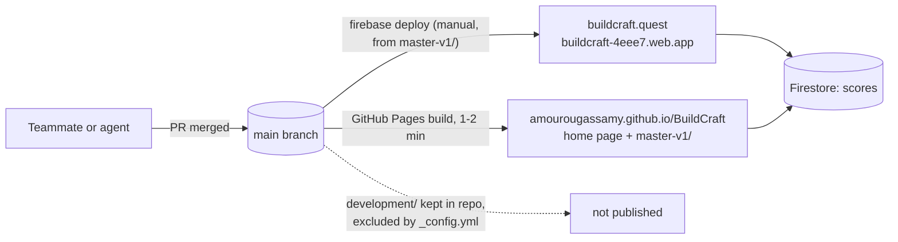
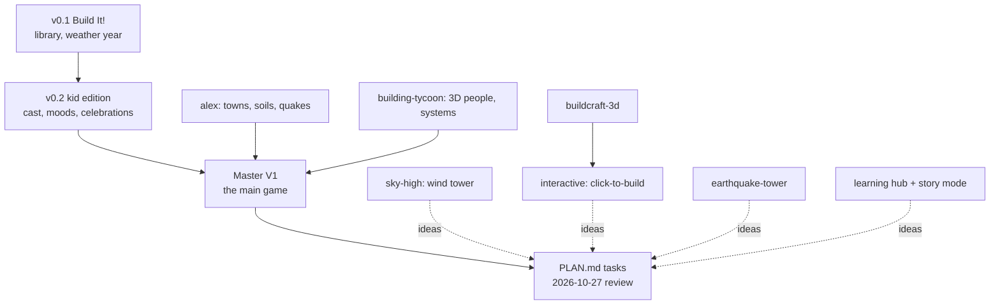
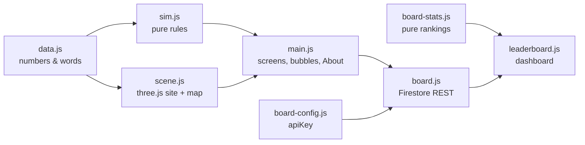

# BuildCraft repo guide

Detailed reference behind `AGENTS.md`: how each game is wired, so you can change one without reading all of it first. Facts checked against the code on 2026-10-28; if this guide and the code disagree, the code wins, so fix the guide.

## How the repo fits together

Only `index.html` (the home page) and `master-v1/` are published. Everything built during the hackathon lives in `development/` for reference and runs from a local server.

Solid arrows: ideas or code that went into the next thing. Dotted: idea sources not yet used.

## `master-v1/` (the app)

The team's main game. ES modules with three.js 0.160.1 **vendored** in `vendor/`, so it runs offline. `firebase.json` hosts this folder and holds the Firestore rules. The folder README covers gameplay, hosting, the leaderboard and the rules in kid terms.

- **`js/data.js`** holds every number and word:
  - Timing: `DAYS = 360` inside the sim, shown to players as `WEEKS = 52`. `DAYS_PER_SEC = 8`, so a year takes about 45 s at 1×.
  - Damage and health constants.
  - Report-card `WEIGHTS` and `GRADES`; `PASS_SCORE = 65` (a C) unlocks the next site.
  - `SOILS` (rock, firm, clay, sand): each has a foundation `need` and `layers` (the dig-down profile, top first). Sand liquefies.
  - `HAZARDS` (quake, wind, flood, heat) and the `BREAKS` that each one causes.
  - `SECTIONS` → `items` → `options`: the design choices.
    - Option 0 is Code Minimum, except items marked `info: true` (the soil report, getting upstairs).
    - Items with `minFloors` only show on taller buildings (elevator, restrooms).
    - Effects are `quake`/`wind`/`flood`/`heat`/`fire` strength, plus `happy`, `eco`, `power` and `bolted`.
  - `CAST` (`loves` and `worries`).
  - `LEVELS`: 5 fixed sites (Rocky Ridge, Prairie Plains, Breezy Bay, Shaky Hills, Mega City). Each has `floors`, `soil`, `budget`, `shell`, a map position and `events: [hazard, power, month]`.
- **`js/sim.js`** is pure and has no randomness:
  - `designStats()`, `strength()`, `soilNeed()`, `systemsHappy()` (elevator and restrooms scaled by storeys).
  - `createRun()`, `advance()` on a fixed `TICK`, `repair()`, `reportCard()`, `lessons()`.
  - `simulate()` plus `autoRepair()` for tests and calibration.
  - Each point a hazard beats the building by costs 25% health. Below 50% the doors close; at 0% the building falls down.
- **`js/scene.js`:**
  - `createSite()`: the lot (grass, soil `profile` from `SOILS[...].layers`, hidden until the soil report is bought) inside a big fogged grass field with a street and neighbour houses.
    - The building: slabs, columns, glass facades, furniture, an elevator shaft, sprinkler pipes.
    - People with emoji and speech bubbles, the pet, hazard effects, and the HVAC helicopter.
    - The camera can orbit below ground to show the foundation.
  - `createMap()`: the island map, with terrain per site and the river.
- **`js/main.js`:**
  - Screens are title → map → brief → design (`renderDesign()` fills `#panel`) → run → report or game over.
  - It also holds the speech-bubble chatter (`setTalkPhase()`, `talkAboutChoice()`), the ℹ️ About page (`TEAM`) and the opt-in leaderboard post (`postScore()`).
  - Progress is saved to localStorage.
- **Leaderboard:**
  - `js/board.js` uses REST only (no Firebase SDK): anonymous `accounts:signUp`, a `documents:commit` with a `REQUEST_TIME` transform, and `:runQuery` for the newest 1000.
  - `js/board-stats.js` holds the pure rankings and `cleanName()`. `leaderboard.html` with `js/leaderboard.js` is the dashboard; it polls every 15 s and `?demo` shows sample data.
  - `firestore.rules` validates every field.
  - An empty `apiKey` in `js/board-config.js` switches it all off.
- **Check:** `npm test` (`tests/sim.test.mjs`, `tests/board-stats.test.mjs`) and `npm run calibrate` (`tools/calibrate.mjs` plays every affordable design on every site).

## `development/`: the hackathon's earlier versions

Kept for reference and not published (`_config.yml` excludes the folder from GitHub Pages, and Firebase deploys only `master-v1/`). `development/index.html` is the old launcher. Run any of them with `python3 -m http.server 8000` from the repo root, then open `http://localhost:8000/development/<folder>/`.

## `development/buildcraft-v0.1/` and `development/buildcraft-v0.2/`

Both use the same skeleton: classic `<script>` tags (no modules, no fetch), so they also run from `file://`. Each script is an IIFE that hangs one global on `window`.

| | v0.1 "Build It!" | v0.2 kid edition |
| --- | --- | --- |
| Load order (`index.html`) | `data.js` → `sim.js` → `building.js` → `ui.js` | `data.js` → `sim.js` → `art.js` → `fx.js` → `ui.js` |
| Globals | `GAME`, `SIM`, `drawBuilding()` | `GAME`, `SIM`, `ART`, `FX` |
| Screens | brief G-001 → design A-101 → weather year W-201 (construction, then 4 seasons) → results R-301 | meet → build → opening (ribbon) → year (each season: incoming, then reveal) → stars |
| Art | `building.js`: side-view SVG string | `art.js` (dollhouse, cast, storms) + `fx.js` (canvas confetti and fireworks, Web Audio sounds) |
| Score | 4 meters 0–100, weighted by `weights` | same, plus stars (3 at 75+, 2 at 50+); any ghost caps the result at 2 stars |
| Bundle | `python3 tools/bundle.py` → `dist/build-it.html` | → `dist/buildcraft.html` |

**`data.js` (`window.GAME`)** holds every number and word:
- `scenario`, `budget`, `basePackage`, `feeRate`, `weights`.
- `hazards`: per hazard, `label`, `repair` ($ per point) and `days`; v0.2 adds `power`, `deadly`, `hurt` and `crash`.
- `governs`: hazard → decision IDs.
- `decisions`: `[{ id, title, type: "one"|"multi", options: [{ id, name, cost, ratings{hazard: 0–10}, bonus, energyPct, energySave, planet, risk{chance, cost}, … }] }]`.
- `defaultChoices`, `presets`, `weatherDeck`, `demoWeather`, `reviews`.
- v0.2 also has `cast[]` (`loves` uses `"decision:option"` keys, plus `worries` and `exposure`), `badges` and `rainyDayRate`.

**`sim.js` (`window.SIM`)** is pure rules:
- Cost = base + options + fees + contingency.
- Rating = the minimum over the governing decisions, plus bonuses, clamped to 0–10.
- `damage = max(0, intensity − rating) × repair`; days closed = `round(over × days)`.
- Randomness is a seeded mulberry32-style RNG; demo mode forces the soils surprise.
- `findFix()` writes "the lesson". In v0.1 it checks only the first governing decision; in v0.2 it checks all of them.
- v0.2 moods: a cast member starts happy if they love a chosen option. A storm that beats the rating by 1+ makes worriers sad; one that beats it by 3+ on a `deadly` hazard turns the most exposed into a ghost.

**`ui.js`** keeps one `state` object, re-renders `app.innerHTML`, and handles clicks through delegated `data-*` attributes. v0.2 stores `buildcraft.gentle`, `buildcraft.muted` and `buildcraft.best` in localStorage.

**Change safely:**
- Adding a JS file means updating the `<script>` order **and** the list in `tools/bundle.py`.
- Renaming a decision or option ID means updating `governs`, presets, `defaultChoices`, `cast[].loves` and the hard-coded IDs in `sim.js` (e.g. `option("soils", …)`).

## Single-file prototypes

| Folder | Owner | Size | Notes |
| --- | --- | --- | --- |
| `development/alex/` | Alex | `index.html` (v3) 56 KB, `v2.html` 30 KB, `v1-build-it-strong.html` 12 KB | Readable vanilla JS. v3 state lives in one global `S`. Tuning constants sit at the top of the script (`MONTH_MS`, `BUILD_MS`, `SOILS`, `TOWNS`, `TYPES`, `FLOORS`, `CATS`). The foundation must match the soil (`soilNeed()`). 900×500 canvas plus an SVG happiness needle. Works offline. |
| `development/sky-high-builders/` | Logan | 10 KB, minified | 3×6 grid of Frame ($10) / Braced ($16) pieces, $120 budget. Resistance `base×2 + braces×2` vs demand `height×wind`. Win: 3+ storeys survive Strong wind or worse. No external requests. |
| `development/buildcraft-3d/` | Logan | 8.5 KB, minified | three.js 0.160.1 via full jsDelivr URLs. Templates, auto-placed elements (column, beam, slab, brace, wall × steel, concrete, timber), six load sliders (D, L, E, W, S, T), load combinations, D/C index, exaggerated sway. JSON export parts `{x, y, z, w, h, d, type, mat}`. |
| `development/interactive/` | Logan | 9.5 KB, minified | Same layout as buildcraft-3d, now using an import map. Raycast click-to-build snapped to a 3-unit grid, elevation levels 0–8, delete mode, snapshot undo. Wind and seismic weighted ×1.7. JSON parts `{type, x, y, z, dims: [...], mat}` with a 1,000-part limit. Both say `version: 3`, but neither game loads the other's files. |
| `development/earthquake-tower/` | Logan | 5.9 KB, minified | three.js 0.160.1 via import map. Basic vs braced five-storey tower, earthquake intensity and animation-speed sliders, shake / pause / reset, results panel. |

The three.js files call functions from `onclick="window.fn()"` attributes, so the module script assigns those functions to `window`. Keep that pattern when editing.

## `development/building-tycoon/` (Tom)

ES modules, so it needs a local server. `js/data.js` holds numbers and words; `js/sim.js` is the pure model, tested with `node --test`; `js/scene.js` is the three.js world; `js/ui.js` the panels; `js/main.js` the loop. The folder README has diagrams, the model, complexity and edge cases; its `NOTES.md` has decisions and calibration.

## `development/learning-hub-nextjs/` (nabdo)

An Abacus.AI export. Hosted at https://ncseahackathon.ssoe.abacus.ai/; it doesn't run on Pages.

- **Stack:** Next 16 (App Router), React 19, TypeScript, Tailwind 3, shadcn/ui on Radix, three 0.180, Prisma 6 (schema has no models; no database is needed to play). Yarn with `nodeLinker: node-modules`; no lockfile. `next-auth` is installed but not wired up.
- **Scripts:** `dev`, `build`, `start`, `lint`. The test file `tests/game-model.test.ts` uses `node:assert`; run it with `yarn tsx tests/game-model.test.ts` (unverified).
- **Env:** `DATABASE_URL` is referenced by the schema only; `NEXTAUTH_URL` only feeds `metadataBase`. `NEXT_DIST_DIR` and `NEXT_OUTPUT_MODE` are optional.
- **Game:** `app/page.tsx` renders `components/game/game.tsx`, which drives `building-scene.tsx`. The design saves to localStorage key `ncsea-building-design-v1`. The model lives in `lib/game/`:
  - `assumptions.ts`: budget $1.8M, 4,000 sf target, 78 °F comfort limit, costs, thermal inputs.
  - `design.ts`: the `Design` type, baseline, `validDesign()`.
  - `engineering.ts`: `calculate()`, a one-zone hot-day heat balance over 12 h in 5-minute steps.
  - `review.ts`: `review()` checks, each Meets / Does not meet / Needs information / Not evaluated.
- **Abacus leftovers:**
  - `.yarnrc.yml` points the global cache at `/opt/hostedapp/...`, so change it for local installs.
  - `next.config.js` has `ignoreBuildErrors: true`.
  - `layout.tsx` loads an Abacus script.
  - `instrumentation-client.js` reports errors to `/__abacus/client-error`.
  - `STYLE_GUIDE.md` is the generic Abacus template.

### Story mode (unzipped 2026-10-28)

nabdo's newer upload, `ncsea_hackathon_nextjs_space (1).zip` (commit `a7f3e15`), was unzipped over the folder on 2026-10-28 and the zip deleted. Compared with the first export:

- **New files:** `components/game/story-guide.tsx` and `app/story-mode.css`. They add a story mode: guide "Nova · your building buddy" in the town of Breezy Bay, five design steps (Shape, Gravity, Lateral, Foundation, Comfort), and three phases (design, test with "Surprise me!", outcome with "Revise design").
- **Changed files:** `app/layout.tsx`, `components/game/game.tsx`, `building-scene.tsx`, all four `lib/game/*.ts`, and the test file.
- **Model changes:**
  - `Design` gains `material`, `lateral` (braced or moment), `braceSize`, `foundationType` and `heating` (kW).
  - New `migrateDesign()` upgrades saved designs.
  - New cold-day scenario (0 °C outside, 20 °C setpoint).
  - Heating costs $300 per kW; braces are costed only when the system is braced.
  - New reviews: cold-day comfort, plus a "Not evaluated" check on lateral system and story height.
