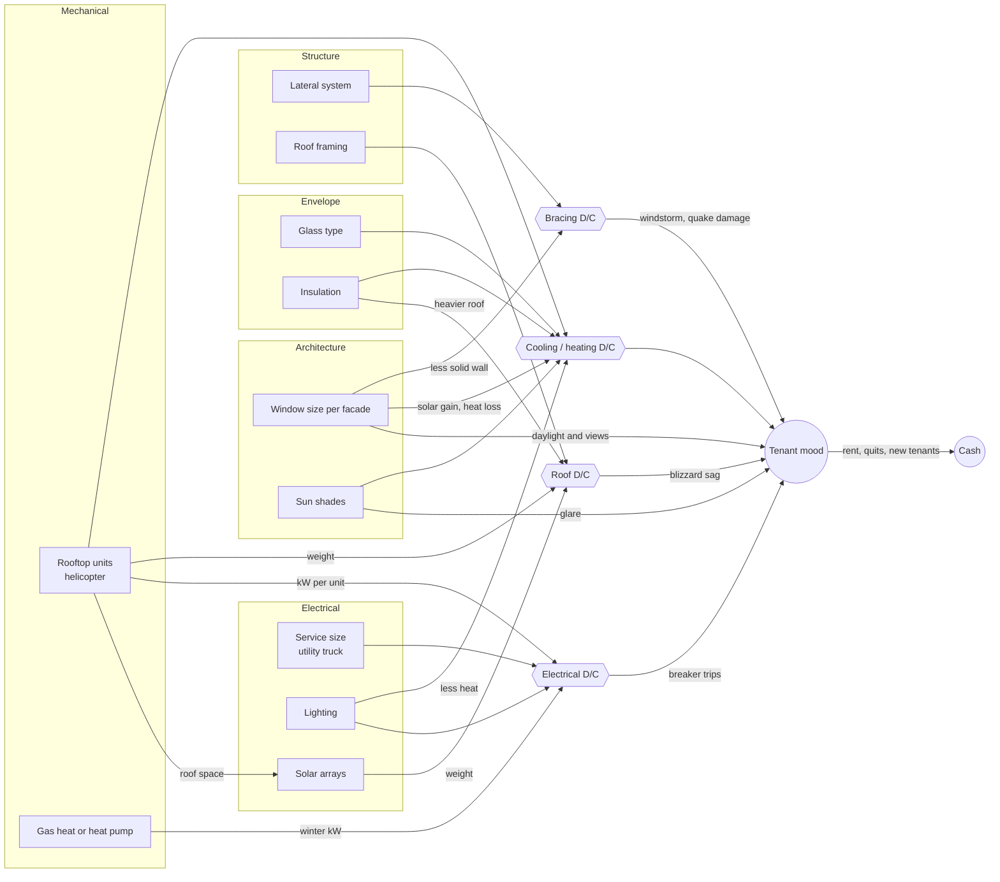
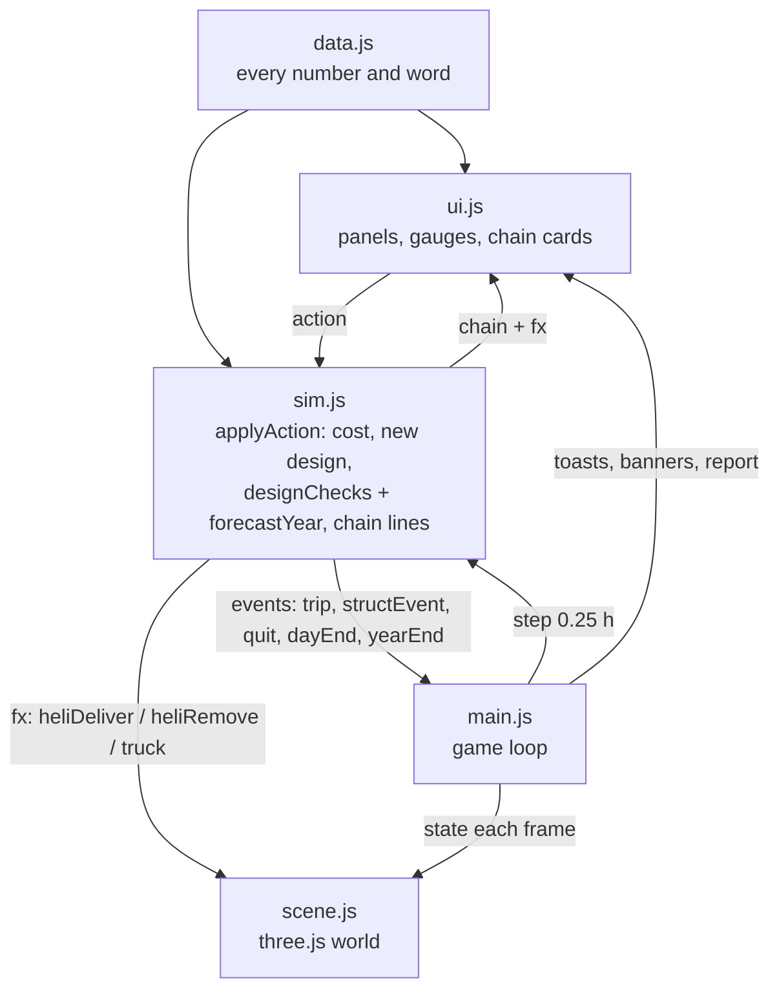

# Building Tycoon

Owner: Tom. A prototype in the BuildCraft repo.

A 3-storey Chicago office you run for one year, viewed in isometric 3D (orbit, zoom, snap-rotate). Tenants walk in every morning and out every evening, and their mood follows how well the building works. Every design choice ripples through the other disciplines:

- Bigger windows make people happier, but they let in summer sun, leak winter heat and cut holes in the shear walls.
- A helicopter flies in another rooftop unit when it gets hot. The unit then loads the roof framing and the electrical service.
- Heat pumps drop the gas bill but push the electrical service hard on cold mornings.

Play: https://amourougassamy.github.io/BuildCraft/prototypes/building-tycoon/ (needs internet for Three.js).

All numbers are illustrative game values, not design values or code checks.

## How to play

1. Click **Open the building**. Time starts in June at 6 AM. Each month is played as one representative day; nights fly by.
2. Change the design in the left panel. It has five tabs: Architecture, Structure, Envelope, Mechanical and Electrical.
3. Watch the **Load vs capacity** gauges on the right. Each one is a demand/capacity ratio: green is under 0.85, yellow is 0.85 to 1.0, and red is over 1.0. Click a gauge to open the tab that fixes it.
4. Every change adds a **chain reaction** card listing what it did to the other disciplines, and the affected part flashes in 3D.
5. Five events come during the year: a heat wave, a cold snap, a blizzard (roof check), a windstorm and an earthquake (bracing check).
6. At year end you get a report card per discipline. You can replay the same weather with your design, start over, or roll a new year.

Controls: drag to orbit · scroll to zoom · right-drag to pan · Q / E rotate 90° · H heat view · Space pause · 1/2/3 speed. **Engineer view** shows the numbers behind every gauge.

## How the disciplines interact



## How it works inside



**Simulation (`js/sim.js`).** Pure functions with no DOM or three.js, so the same code runs in the browser and in `node --test`.

- **Zones.** 3 floors × 4 orientations make 12 perimeter zones. Each zone has window area, U·A, ventilation and thermal mass (120 kJ/K per m²).
- **Weather.** Each month gets one representative day with Chicago highs and lows, seeded clouds and one seeded event per type. The sun position comes from latitude, day of year and hour. Facade irradiance depends on incidence angle, and south overhangs are modelled geometrically (they block high summer sun and let low winter sun through).
- **Every 15 minutes:**
  1. Each zone's free-running heat balance is computed: solar, people, lights, plugs and conduction.
  2. HVAC capacity (units × 28 kW) is shared across zones in proportion to their demand.
  3. Temperatures update with explicit Euler; the time constant is about 18 h, so it stays stable.
  4. Electrical load is summed, including PV. If it exceeds the service, the breaker trips and the building has a 2-hour blackout.
  5. Each occupant's mood moves toward a target set by temperature, view, glare, blackout and sway.
- **Design checks** (the gauges) are deterministic one-shot calculations:
  - Cooling: a clear 91 °F July day with every desk full.
  - Heating: a −4 °F morning.
  - Electrical: everything that could run at once. Solar isn't counted, because cloudy days happen.
  - Roof: dead load + insulation + 22 psf design snow + equipment.
  - Bracing: max(wind, seismic) against capacity. Shear-wall capacity is 1.5 kips/ft × the solid length of the walls parallel to the load, so windows reduce it.
- **Forecast.** Each action also re-runs the whole year with full occupancy (12 days × 96 steps × 12 zones ≈ 14k zone updates, a few ms), so the chain card can show the change in the yearly energy bill and in too-hot hours.
- **Complexity.** Each step is O(zones + people). One year is about 1,150 steps. Memory is O(zones + people).
- **Determinism.** Same seed + same actions = the same year (tested). `?seed=123` in the URL picks a different year.
- **Edge cases handled:**
  - A full roof (12 slots) blocks new units and solar.
  - Heat-pump strip heat at −4 °F.
  - Pull-down after a blackout can trip the breaker again (cold-load pickup).
  - Damage sends everyone home for the day.
  - A roof sag closes the top floor.
  - Cash can go negative; the report card penalizes it.

**3D (`js/scene.js`).** Three.js 0.160.1 from jsDelivr (the same version as the BuildCraft 3D prototype), orthographic camera with OrbitControls. The building rebuilds only when its design changes. The scene reads the sim state each frame and never changes it.

## Files

| File | What's in it |
| --- | --- |
| `js/data.js` | Every number and every word: geometry, weather, options, costs, events, chain-reaction explanations |
| `js/sim.js` | Thermal, structural and electrical model, tenants, money, design checks, forecast, report card |
| `js/scene.js` | Building, roof equipment, people, helicopter, utility truck, sun, seasons, weather, heat view |
| `js/ui.js` | Tabs and option cards, gauges, chain-reaction feed, toasts, speech bubbles, intro and report |
| `js/main.js` | Game loop and wiring |
| `tests/sim.test.mjs` | Unit tests for the model (`node --test`) |
| `tools/calibrate.mjs` | Prints the checks for fixed scenarios plus two full years; used to tune `data.js` |
| `tools/serve.py` | Local server with caching off (modules need http://) |

## Run it locally

```sh
python3 prototypes/building-tycoon/tools/serve.py   # then open http://127.0.0.1:8765/prototypes/building-tycoon/
node --test prototypes/building-tycoon/tests/*.test.mjs
node prototypes/building-tycoon/tools/calibrate.mjs [seed]
```

Debug from the browser console: `buildcraft.fastForward(24)` skips a day; `buildcraft.state` is the whole game state.
